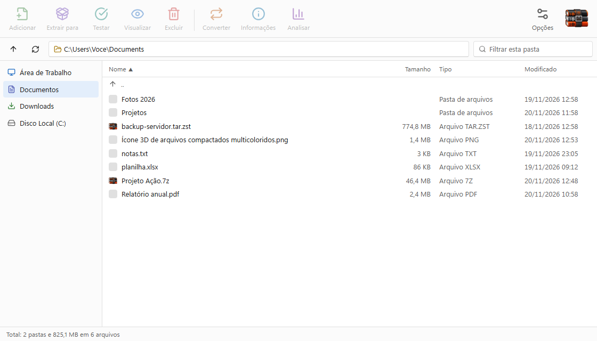
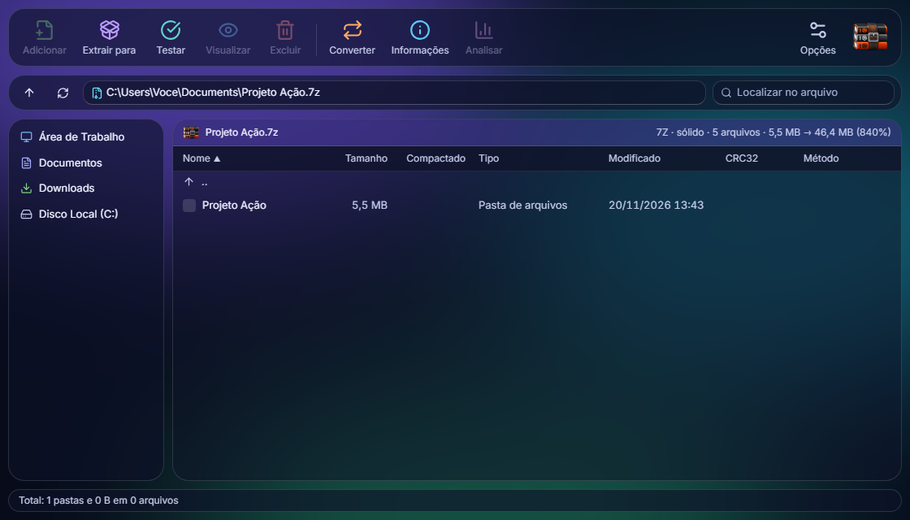
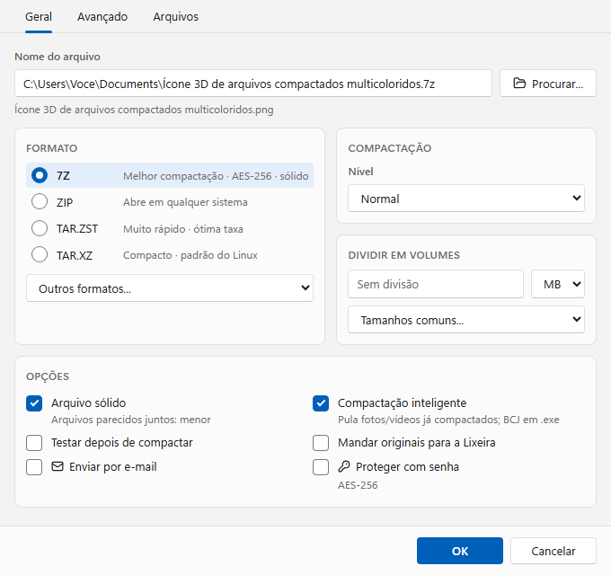
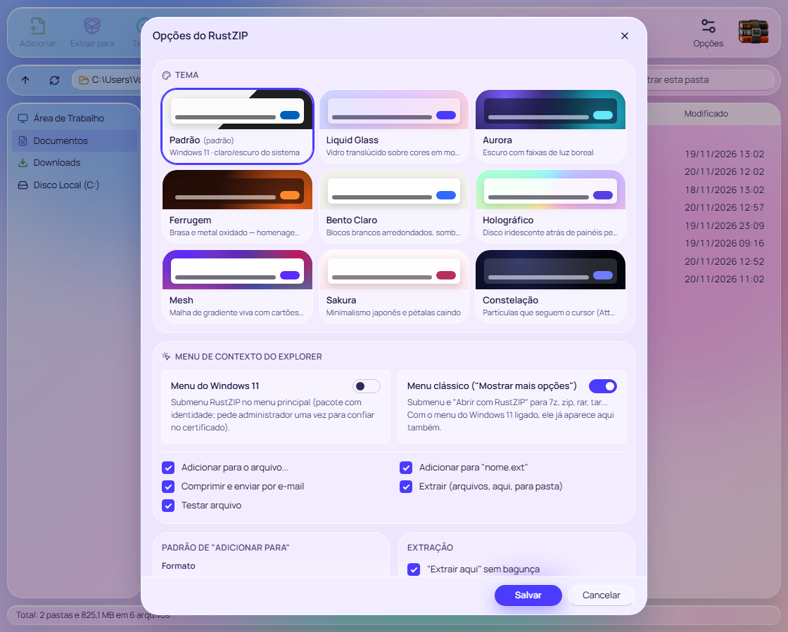
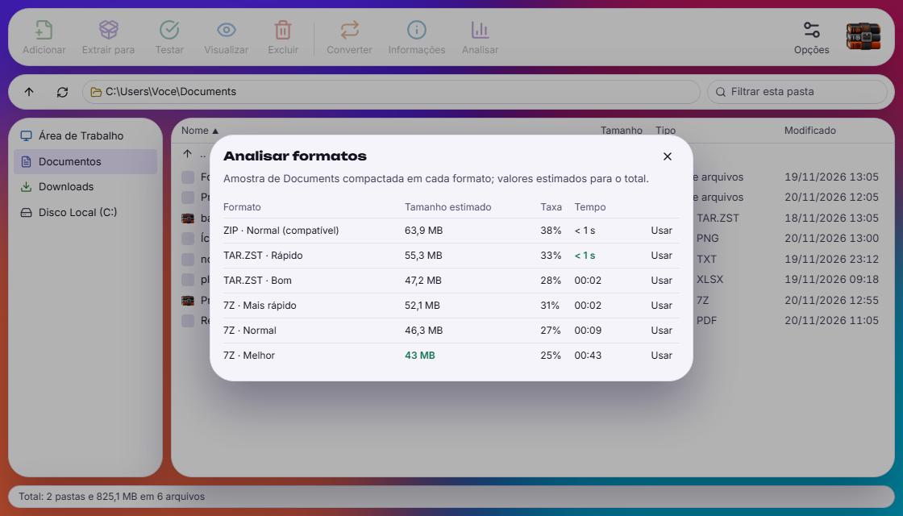
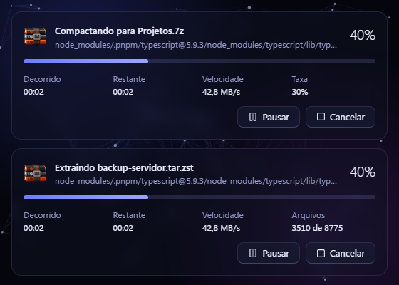
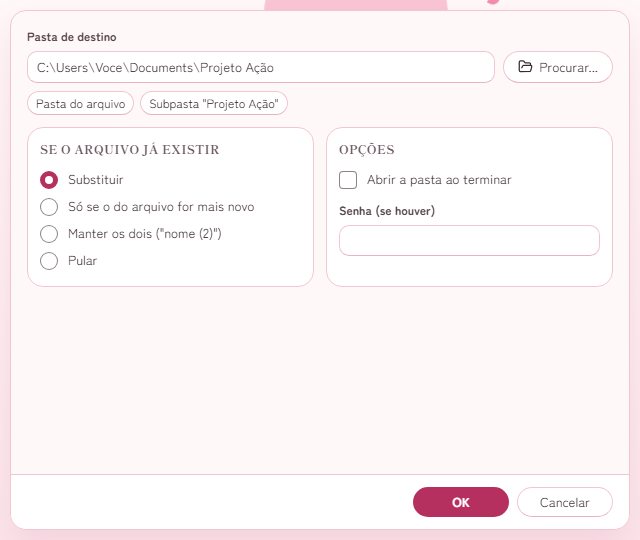
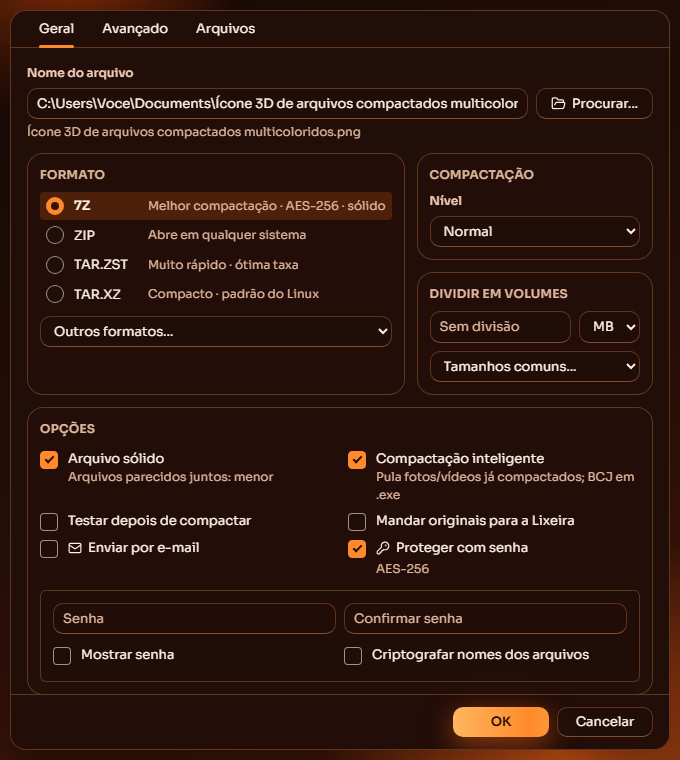

<div align="center">


# RustZIP

**Compactador de arquivos para Windows feito em Rust, com interface em React.**
Um substituto para o WinRAR que compacta mais rápido, lê mais formatos e entra no menu de
contexto do Windows 11.

[](LICENSE)


[Baixar](https://github.com/HiagoARJ/RustZIP/releases/latest) ·
[Documentação](docs/README.md) ·
[Desempenho](docs/DESEMPENHO.md) ·
[Temas](docs/TEMAS-E-ACESSIBILIDADE.md)

</div>

<p align="center">
  
  
</p>

## O que ele faz

- **Compacta** em 7Z, ZIP, TAR.ZST, TAR.XZ, TAR.GZ, TAR.BZ2, TAR.LZ4, TAR.BR, TAR e, para um arquivo
  só, ZST, XZ, GZ, BZ2, LZ4 e BR.
- **Extrai e testa** tudo isso e mais **RAR/RAR5** (inclusive com senha, nomes criptografados e em
  volumes), volumes `.001`, autoextraíveis ZIP/RAR e formatos baseados em ZIP (`.docx`, `.apk`,
  `.jar`, `.epub`...).
- **Altera arquivos já existentes**: adicionar, excluir e renomear entradas dentro de ZIP e 7Z sem
  recompactar o resto, e converter entre formatos (por exemplo RAR → 7Z).
- **Senha AES-256** em 7Z (também nos nomes) e ZIP, **divisão em volumes**, comentário de ZIP,
  exclusão por padrões (`*.tmp`, `node_modules`), testar depois de compactar e mandar os originais
  para a Lixeira.
- **Menu de contexto do Explorer**, no menu principal do Windows 11 e no clássico: *Adicionar para o
  arquivo...*, *Adicionar para "nome.7z"*, *Comprimir e enviar por e-mail*, *Extrair arquivos...*,
  *Extrair aqui*, *Extrair para "nome\"* e *Testar arquivo*.
- **Analisar formatos**: compacta uma amostra em vários formatos e estima tamanho e tempo antes de
  você escolher.
- **9 temas** (Padrão do Windows 11, Liquid Glass, Aurora, Ferrugem, Bento Claro, Holográfico, Mesh,
  Sakura e Constelação), todos verificados quanto ao contraste de textos e ícones.
- **Linha de comando** (`rz.exe`), no estilo do `Rar.exe`.

## Mais rápido e mais compacto

Medido no mesmo computador (16 threads), com 178 MB em 8.775 arquivos (código, `node_modules`,
executáveis):

| Ferramenta e modo | Tempo | Tamanho |
|---|---:|---:|
| WinRAR · RAR Normal | 4,72 s | 60,4 MB |
| WinRAR · RAR Melhor, sólido | 7,25 s | 48,5 MB |
| WinRAR · ZIP Normal | 5,30 s | 66,9 MB |
| **RustZIP · ZIP Normal** | **0,77 s** | 67,7 MB |
| **RustZIP · 7Z Mais rápida** | **1,78 s** | **54,6 MB** |
| **RustZIP · TAR.ZST Boa** | **2,27 s** | 49,5 MB |
| RustZIP · 7Z Normal | 9,03 s | 48,7 MB |
| RustZIP · 7Z Boa | 16,3 s | **47,1 MB** |

- O **ZIP** sai **6,9× mais rápido** que o do WinRAR, praticamente do mesmo tamanho.
- O **7Z Mais rápida** é **2,6× mais rápido e 10% menor** que o RAR Normal.
- O **TAR.ZST Boa** é **3,2× mais rápido** que o RAR Melhor, com 2% a mais de tamanho.
- A extração empata com o WinRAR: o que pesa é o Windows criar cada arquivo (~1 ms com o
  antivírus).

De onde vem a diferença e como medir: [docs/DESEMPENHO.md](docs/DESEMPENHO.md).

## Instalação

1. Baixe `RustZIP-<versão>-windows-x64.zip` em
   [Releases](https://github.com/HiagoARJ/RustZIP/releases/latest) e extraia numa pasta fixa (por
   exemplo `Documentos\RustZIP`).
2. Abra `RustZIP.exe`. Precisa do WebView2, que já vem no Windows 10 e 11 atualizados.
3. Para o menu de contexto, vá em **Opções → Menu de contexto do Explorer** e ligue o **Menu do
   Windows 11** (pede administrador uma vez, só para confiar no certificado do pacote do menu) e/ou
   o **Menu clássico**. Também dá para fazer pelo terminal:

   ```powershell
   .\RustZIP.exe --register --modern   # menu do Windows 11 + "Abrir com"
   .\RustZIP.exe --register            # só o menu clássico + "Abrir com"
   .\RustZIP.exe --unregister          # remove tudo
   ```

O RustZIP não troca o programa padrão dos seus arquivos: ele só aparece em "Abrir com". Detalhes e
o que cada opção grava no sistema: [docs/MENU-DO-EXPLORER.md](docs/MENU-DO-EXPLORER.md).

## Telas

<p align="center">
  
  
  
</p>
<p align="center">
  
  
  
</p>

Todas as telas em todos os temas: [docs/TEMAS-E-ACESSIBILIDADE.md](docs/TEMAS-E-ACESSIBILIDADE.md).

## Linha de comando

```powershell
rz a projeto.7z .\src .\docs        # compactar (formato pela extensão)
rz a -m9 -p"senha" -hp backup.7z D:\dados
rz a -v700m filmes.7z .\videos     # volumes de 700 MB
rz x arquivo.rar D:\saida          # extrair com caminhos
rz l arquivo.zip                   # listar
rz t arquivo.tar.zst               # testar
rz d arquivo.7z pasta/velho.txt    # excluir entrada
rz c antigo.rar novo.7z            # converter
```

Todas as opções: [docs/LINHA-DE-COMANDO.md](docs/LINHA-DE-COMANDO.md).

## Compilar

Requisitos: Windows 10/11 x64, Rust estável (edição 2024), Visual Studio Build Tools (MSVC),
Node.js 20+ com pnpm e, para o pacote do menu do Windows 11, o Windows SDK.

```powershell
pnpm --dir ui install
pnpm --dir ui build
cargo build --release -p rustzip-app --features tauri/custom-protocol
cargo build --release -p rustzip-shell -p rustzip-cli
cargo test -p rustzip-core
```

Passo a passo, pacote do menu e instalação local: [docs/COMPILAR.md](docs/COMPILAR.md).

## Estrutura

```text
crates/core     motor: formatos, extração, criação, alteração e progresso
crates/cli      rz.exe, a linha de comando
crates/shell    rustzip_shell.dll, o submenu do Explorer (COM, IExplorerCommand)
src-tauri       RustZIP.exe: janelas, comandos e integração com o Windows
ui              interface React 19 + Vite + Tailwind 4
tools/iconkit   gera o ícone (JXL → AVIF → ICO/PNG)
packaging       manifesto do pacote do menu e scripts de instalação e release
docs            documentação e imagens
```

Como as partes se encaixam: [docs/ARQUITETURA.md](docs/ARQUITETURA.md).

## Limitações conhecidas

- **Não cria arquivos RAR**: o algoritmo é proprietário e a licença do UnRAR proíbe recriá-lo. Use
  7Z para a melhor compactação.
- Ainda não cria autoextraíveis (SFX) nem registro de recuperação.
- O envio por e-mail usa o cliente padrão do Windows (MAPI simples). O Outlook novo não atende esse
  pedido; nesse caso o RustZIP mostra o arquivo no Explorer para você anexar.
- Só Windows 10/11 x64.

## Licença

Código sob a [licença MIT](LICENSE). Os executáveis incluem bibliotecas de terceiros com licenças
próprias, entre elas o UnRAR (extração de RAR); veja [THIRD-PARTY-NOTICES.md](THIRD-PARTY-NOTICES.md).

WinRAR e RAR são marcas da win.rar GmbH. O RustZIP é um projeto independente, sem vínculo com a
win.rar GmbH, e não contém código do WinRAR.
