# Temas e acessibilidade

O tema é escolhido em **Opções → Tema**, com prévia ao vivo. Ao salvar, todas as janelas abertas
mudam juntas. "Cancelar" (ou fechar as Opções) desfaz a prévia.

| Tema | Estilo | Fontes |
|---|---|---|
| **Padrão** | Windows 11 (Fluent); segue o claro/escuro do sistema | Segoe UI |
| Liquid Glass | painéis de vidro translúcido sobre manchas de cor em movimento | Manrope |
| Aurora | escuro, com faixas de luz e botões em gradiente animado | Inter, Space Grotesk |
| Ferrugem | brasa e metal oxidado, brilho quente pulsando | Sora |
| Bento Claro | blocos brancos bem arredondados, sombras macias | Instrument Sans |
| Holográfico | disco iridescente girando atrás de painéis perolados | Plus Jakarta Sans |
| Mesh | malha de gradiente saturada com cartões brancos | Inter, Unbounded |
| Sakura | minimalismo japonês, pétalas caindo | Zen Maru Gothic, Shippori Mincho |
| Constelação | estrelas ligadas por linhas que seguem o cursor | Segoe UI |

As fontes vêm junto com o aplicativo (só o subconjunto latino); nada é baixado da internet.
Com "Mostrar animações" desligado no Windows (`prefers-reduced-motion`), os cenários e as animações
de entrada param.

As cores ficam em `ui/src/themes.css`, como variáveis em `html[data-theme="..."]`. Os cenários
animados estão em `ui/src/theme.tsx`.

## Verificação de legibilidade

Todas as 18 telas foram fotografadas nos 9 temas, com o Padrão nas versões clara e escura, o que dá
180 combinações. Em cada uma, cada texto, campo, texto de dica, caixa de seleção e ícone visível
teve o contraste medido pelo critério WCAG 2.1:

- texto normal: 4,5:1;
- texto grande (24 px, ou 18,66 px em negrito) e ícones: 3:1;
- bordas de controles (caixas e opções desmarcadas): 3:1.

O fundo de cada item é calculado somando as camadas translúcidas atrás dele, até uma cor opaca ou a
cor representativa do tema.

**Resultado: nenhum item ativo abaixo do mínimo.** Os únicos itens abaixo são botões desabilitados
(1,7 a 2,2:1). O WCAG os isenta, e o tom apagado é o que mostra que estão indisponíveis. O
relatório completo está em [`acessibilidade/contraste.json`](acessibilidade/contraste.json).

O que foi corrigido para chegar lá:

| Problema | Antes | Depois |
|---|---|---|
| Ícones coloridos da barra e da lateral nos temas escuros | 2,2–2,9:1 | paleta própria para fundo escuro |
| Os mesmos ícones em temas claros (ex.: Liquid Glass) | 2,7–2,9:1 | tons mais escuros |
| Texto de dica nos campos e texto secundário no Padrão claro | 2,96 e 3,5:1 | acima de 4,5:1 |
| Borda das caixas de seleção desmarcadas | 1,42:1 | derivada da cor do texto, acima de 3:1 |
| Mesh: diálogos abertos pelo menu com texto direto sobre o roxo | 1,03–1,75:1 | conteúdo num painel |
| Constelação: texto branco no botão principal | 3,6:1 | fundo do botão mais escuro |
| Verde de "melhor resultado" em Analisar | 4,4:1 | escurecido |

Limitações da medição: o texto sobre cenários animados foi medido contra a cor média do tema (nos
pontos mais claros ou escuros da animação o contraste muda um pouco; os textos ficam sobre painéis,
o que reduz isso), e os ícones de tipo de arquivo vêm do Windows, então não entram na medição.

## Todas as telas em todos os temas

Cada imagem mostra uma tela nas 10 variações, nesta ordem: Padrão claro, Padrão escuro, Liquid
Glass, Aurora, Ferrugem / Bento Claro, Holográfico, Mesh, Sakura, Constelação. As fotos usam dados
de exemplo; os ícones de tipo de arquivo aparecem como quadrados cinza porque, fora do aplicativo,
não há ícones do Windows.

### Gerenciador

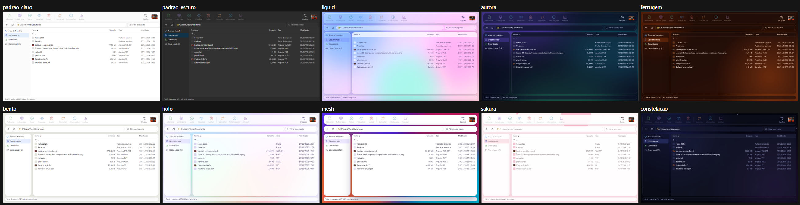
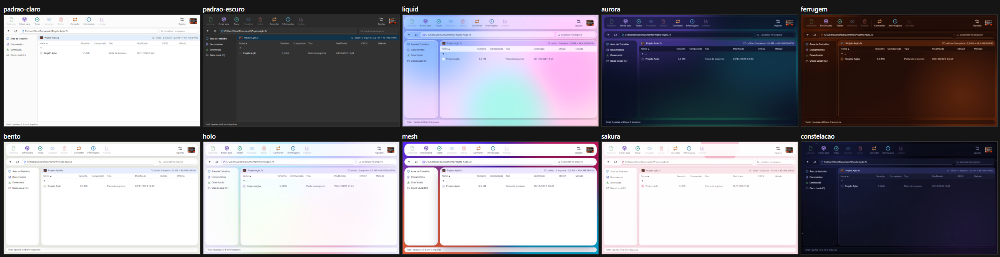

### Opções

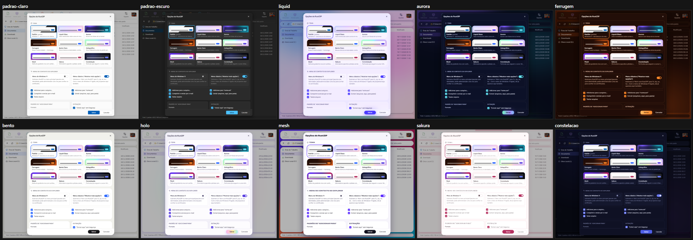

### Diálogos do gerenciador

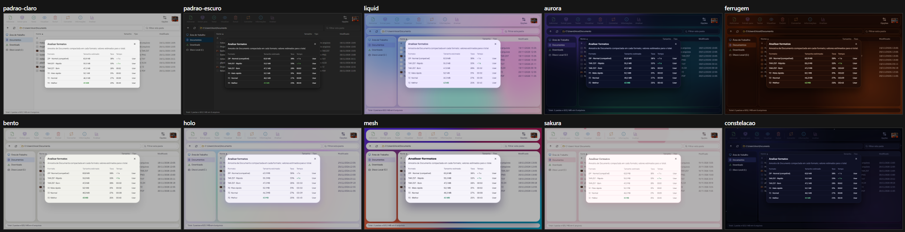
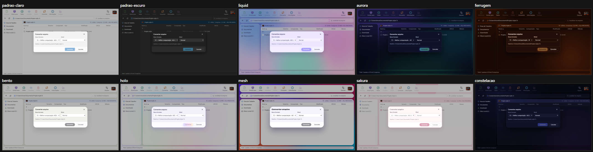
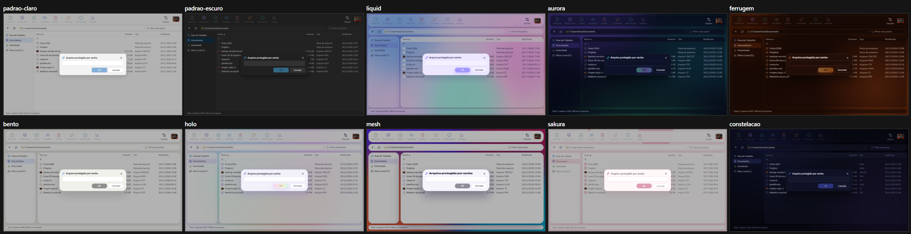
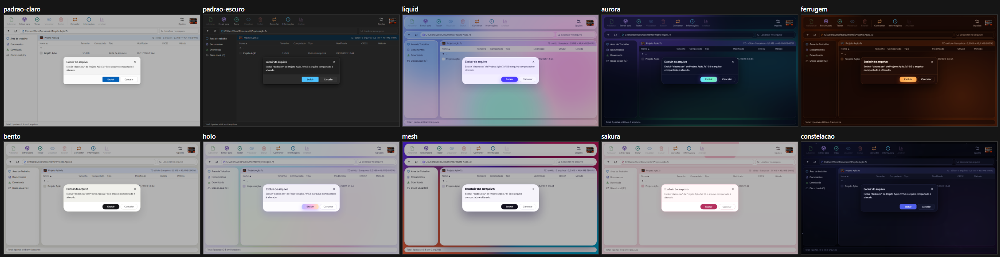
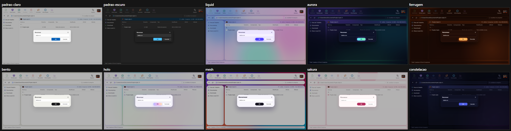
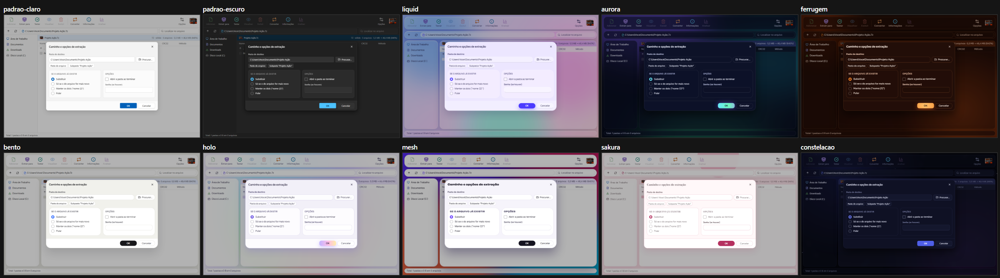
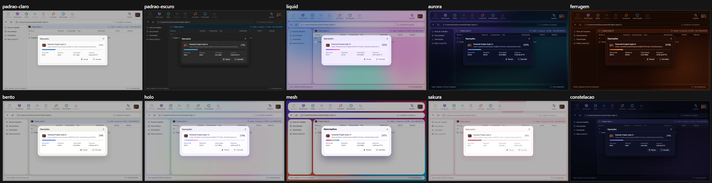

### Janelas abertas pelo menu do Explorer

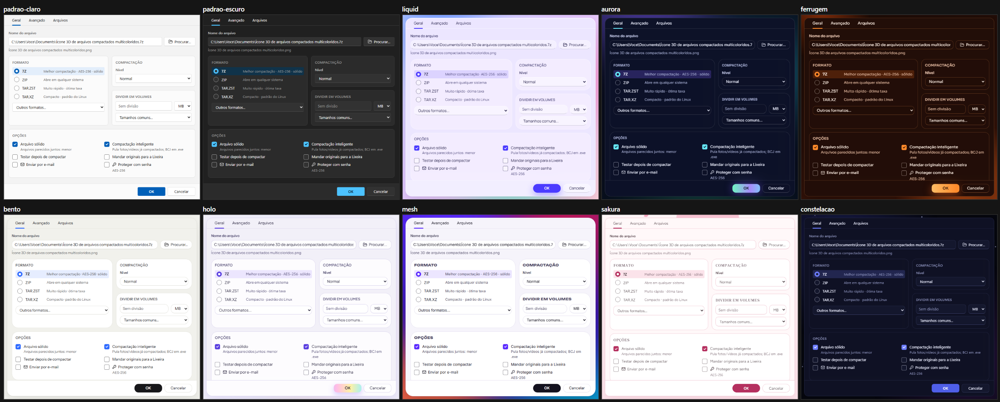
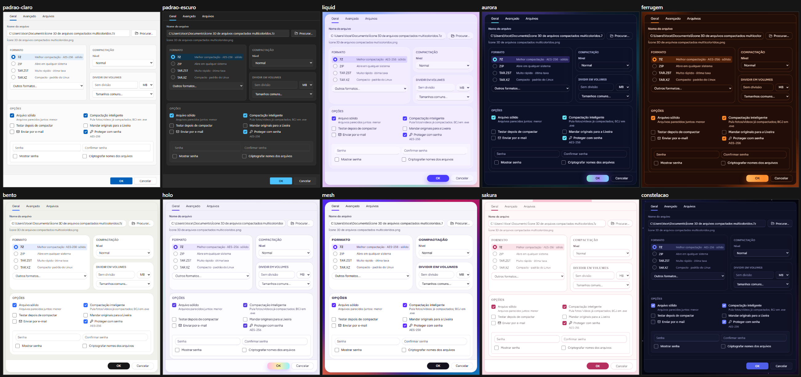
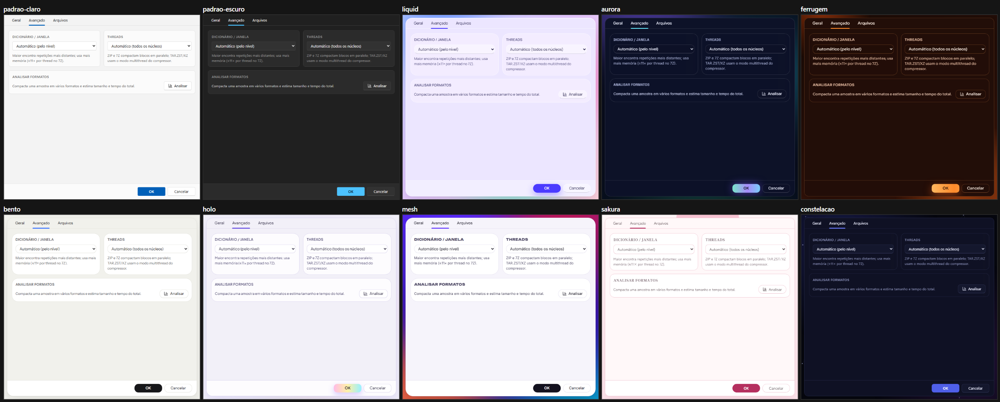
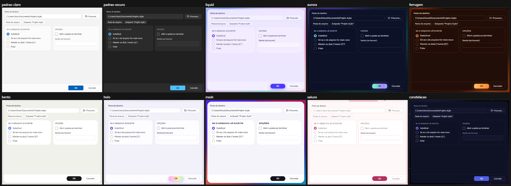
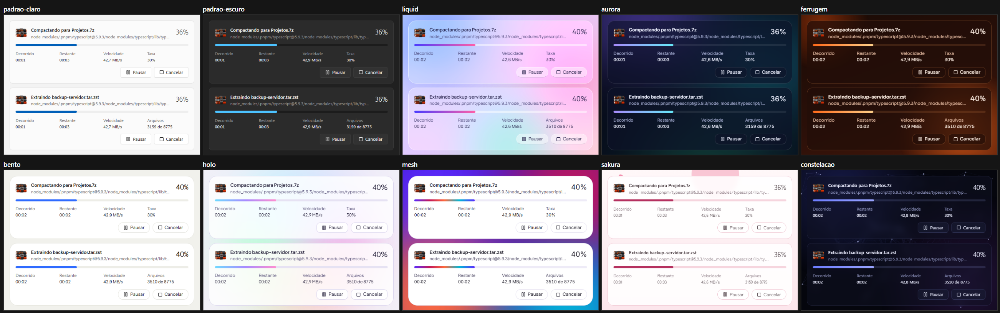
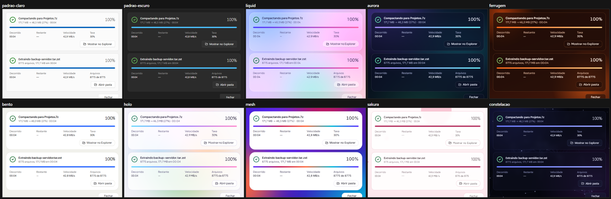
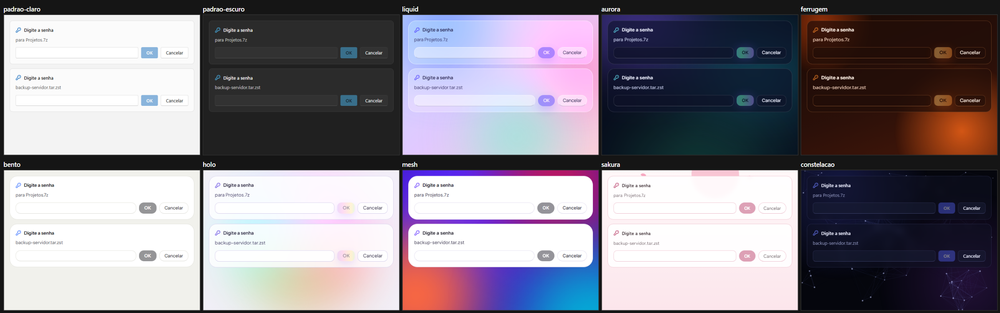
